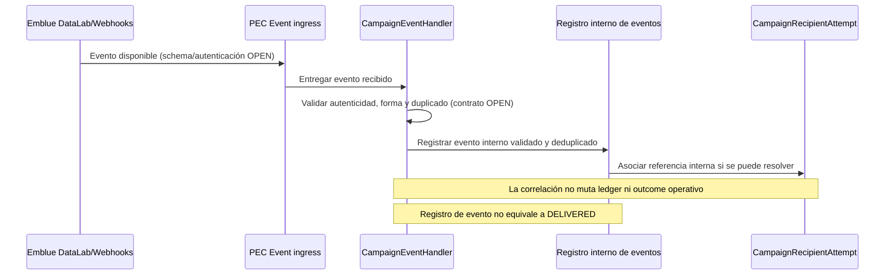
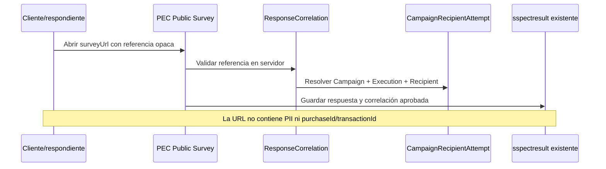

# PEC-SC-INTEG-001 — Especificación de Integraciones

## Automated Survey Campaigns

| Campo | Valor |
|---|---|
| Documento | PEC-SC-INTEG-001 |
| Título | Especificación de Integraciones - Automated Survey Campaigns |
| Estado | DRAFT |
| Versión | 0.5 |
| Fecha | 2026-10-20 |
| Idioma | Español; nombres técnicos en inglés |

> Este documento describe las fronteras funcionales de integración aprobadas para Automated Survey Campaigns. CF/Analytics permanece sin contratos. Para emBlue solo se confirmó parcialmente el envío individual API v2.3 (`POST /emails/send`, request y response con `activityId`); consulta de actividad, procesamiento, entrega, idempotencia y webhooks siguen **OPEN**. No define endpoints externos adicionales ni sustituye ARCH-001, FOUND-001, DATA-001 o API-001.

## 1. Propósito y alcance

Documentar cómo PEC obtiene compras/clientes elegibles, solicita el envío transaccional de invitaciones por Emblue y procesa eventos de entrega disponibles. También establece responsabilidades, tratamiento de fallos, correlación, seguridad y observabilidad requeridos para concretar esos contratos.

Se describen contratos conceptuales. No se fijan rutas, esquemas JSON de proveedor, credenciales, cuotas ni tamaños de lote. Los adapters propuestos son componentes internos y no amplían el contrato Angular de API-001.

## 2. Fuentes y clasificación de información

- **Decisión aprobada:** PEC → Emblue Transactional Email API para invitaciones; Emblue → PEC por DataLab/Webhooks para eventos.
- **Decisión aprobada:** PEC conserva autoridad sobre Campaign, segmentación, post-purchase offset, Scheduler, deduplicación, ejecución y ledger de destinatarios. Emblue administra templates y entrega de email.
- **Decisión aprobada:** SurveyJS ya existe. Campaign referencia una encuesta existente; no crea encuestas.
- **Verificado en código:** el API PEC usa `HttpService` de NestJS/Axios en servicios como `ClientService`, `TcaService` y `CollaboratorService`; esos patrones usan configuración para base URL, transformación de respuestas y el helper `handleExternalHttpError` para mapear fallos HTTP.
- **Verificado en código:** hay clientes con autenticación Bearer y configuración por ambiente. No existe un único patrón uniforme para todos los proveedores.
- **Verificado en código:** `requestDiagnostics` genera `X-Request-ID` y contexto de diagnóstico; el logger incluye sanitización de valores sensibles. Las integraciones nuevas deben evitar payloads completos en logs aun con sanitización.
- **Verificado en código:** no se encontró un adaptador Emblue ni un adaptador de audiencia CF/Analytics para esta funcionalidad.
- **OPEN:** los patrones existentes no demuestran el contrato, autenticación, capacidades ni políticas de los proveedores de esta funcionalidad.

## 2.1 Catálogos Campaign: MOCK temporal

**APPROVED/MOCK:** los contratos reales CF/Analytics no están disponibles. Campaign usa una abstracción propia de proveedor, independiente de servicios generales PEC. El contrato entrega seis catálogos: Division, Department, Company, Auxiliary Classification, Format y Store; no incluye Auxiliary Subclassification en V1.

El proveedor Mock usa IDs/nombres sintéticos identificados como `[MOCK]`/`MOCK-*`. Las relaciones padre-hijo son fixtures de demostración para probar multiselección y limpieza de incompatibles; no describen jerarquías confirmadas de CF. Cada opción tiene `id`, `label`, `parentId` cuando aplique, `active` y `source`. El contrato Angular no cambia al sustituir el proveedor.

MOCK se activa explícitamente con `CAMPAIGN_CATALOG_PROVIDER=mock`, el backend lo rechaza en `NODE_ENV=production` y no cae automáticamente a MOCK ante error de Analytics. El proveedor Analytics es un seam no configurado: no se inventan endpoints, autenticación ni payloads.

Las etiquetas sintéticas MOCK que se muestran en Angular están en español y conservan el prefijo visible de demostración, por ejemplo `[MOCK] División Norte` y `[MOCK] Local Quito Centro`. Se conservan los IDs actuales y la forma de respuesta API; no se localizan ni alteran campos técnicos.

Division, Department y Company son obligatorios solo al programar; se permiten incompletos en DRAFT. Auxiliary Classification, Format y Store son opcionales. Backend valida IDs y relaciones usando el proveedor configurado. Estos catálogos no determinan audiencia, recipients ni envíos; scheduler, Audience Preview real y correos quedan **DEFERRED** mientras no existan contratos reales. Enterprise PEC y Company externa no se equiparan.

## 3. Ownership matrix

| Capacidad / dato | PEC | CF / Analytics | Emblue | SurveyJS / Surveys |
|---|---|---|---|---|
| Campaign, calendario, filtros y offset | Autoritativo: configura y valida | — | — | — |
| Catálogos externos de segmentación y compras/clientes | Consume por adapter; conserva solo lo necesario | Proporciona fuente y significado de datos, pendiente de confirmar | — | — |
| Elegibilidad, audiencia incremental y deduplicación | Calcula/coordina; clave interna `campaignId + purchaseId/transactionId` | Proporciona los datos de compra/cliente requeridos | — | — |
| Template de email | Selecciona la referencia que se acuerde y aporta variables permitidas | — | Propietario del contenido/configuración del template | — |
| Aceptación técnica de solicitud | Registra la respuesta técnica externa | — | Puede aceptar/rechazar según su contrato | — |
| Resultado operativo por recipient | Registra el resultado en `CampaignRecipientAttempt`, separado del ledger | — | Proporciona la respuesta disponible; el significado de `SENT` es OPEN | — |
| Entrega, aperturas, clics y rebotes | Ingiere y registra eventos disponibles, separados de aceptación y estado del ledger | — | Fuente de eventos disponibles; semántica por confirmar | — |
| Encuesta y respuesta | Mantiene Campaign/Execution/Recipient correlation | — | — | Survey existente; conserva respuesta y valida referencia opaca de atribución |
| Token de atribución | Emite/valida referencia opaca según diseño pendiente | — | No debe recibir PII ni token como variable de template por defecto | Lo consume de forma segura en flujo público, mecanismo OPEN |

## 4. Integración A — CF / Analytics

### 4.1 Responsabilidad

Proporcionar a PEC los datos de compras y clientes que correspondan a los filtros de una Campaign y al corte de elegibilidad configurado. La fuente podrá materializarse mediante vistas corporativas, API u otro mecanismo autorizado. No se asume cuál hasta que el propietario de datos entregue el contrato.

Filtros funcionales a evaluar:

- `Divisions` — obligatorio.
- `Departments` — obligatorio.
- `Auxiliary Classifications` — opcional.
- `Companies` — obligatorio.
- `Formats` — opcional.
- `Stores` — opcional.
- Elegibilidad post-compra derivada de `PostPurchaseOffset` y `evaluationDate`: `PurchaseDate + PostPurchaseOffset <= evaluationDate`; zona y corte exacto OPEN.

No se contemplan Auxiliary Subclassification ni rangos manuales de fechas de compra. Los filtros multiselect conservan la semántica aprobada: OR entre valores del mismo grupo y AND entre grupos distintos. PEC debe enviar/aplicar criterios equivalentes según permita el contrato real; la ubicación del filtrado (fuente, PEC o combinación) queda OPEN.

### 4.2 Contrato conceptual de consulta

El adapter interno `AudienceSourceProvider` recibirá una solicitud conceptual con:

| Dato | Propósito |
|---|---|
| `campaignId`, `executionId` | Trazabilidad interna; no se presupone que se envíen al sistema fuente. |
| `divisionIds`, `departmentIds`, `auxiliaryClassificationIds` | Criterios de segmentación multiselect. |
| `companyIds`, `formatIds`, `storeIds` | Criterios comerciales multiselect. |
| `postPurchaseOffset` | Días mínimos después de la compra. |
| `evaluationDate` / cutoff | Fecha de negocio contra la que se determina elegibilidad; zona horaria y semántica exactas del corte OPEN. |
| cursor/página conceptual | Permitir consumo incremental de resultados si el origen lo soporta; mecanismo OPEN. |

El resultado conceptual por compra incluirá los datos mínimos disponibles:

| Campo conceptual | Uso | Tratamiento |
|---|---|---|
| `customerId` | Identificación y asociación interna | Identificador externo; tipo y estabilidad OPEN. |
| `purchaseId` o `transactionId` | Deduplicación por Campaign | Uno de ellos debe ser estable y único en su ámbito; elección y semántica OPEN. |
| `email` | Destino requerido para solicitar invitación | PII; usar transitoriamente y persistir solo según política aprobada. |
| `purchaseDate` | Evaluación de offset y variable opcional | Zona horaria/calendario del origen OPEN. |
| `customerName` | Personalización opcional | PII; solo enviar si existe y es necesario. |
| `companyName`, `formatName`, `storeName` | Personalización opcional | Datos de negocio; opcionales según disponibilidad. |
| otros campos aprobados | Variables de template futuras | No aceptar campos arbitrarios; revisar propósito y sensibilidad antes de habilitarlos. |

Los nombres anteriores son **conceptuales**, no nombres de columnas garantizados. La vista previa de audiencia se calcula en backend y presenta conteos `Eligible Purchases` y `Eligible Customers`; Angular no recibe la lista completa de emails ni el payload original. La audiencia de campañas recurrentes es incremental: cada ejecución evalúa compras elegibles y excluye las ya procesadas por esa Campaign. Un fallo total de lectura no marca compras pendientes como procesadas; deben poder considerarse en ejecuciones posteriores. La recuperación tras downtime debe consolidar el trabajo pendiente, sin crear una ráfaga de ejecuciones atrasadas. No se impone watermark ni lookback; los mecanismos concretos de paginación, recuperación y reconciliación con la fuente permanecen OPEN. Los resultados y snapshots de ejecuciones terminales permanecen inmutables.

### 4.3 OPEN de CF / Analytics

- **OPEN-CF-01:** nombres reales de vistas, endpoints o recurso autorizado.
- **OPEN-CF-02:** conexión, protocolo, ambiente, autenticación, credenciales y propietario operativo.
- **OPEN-CF-03:** columnas reales, tipos, nulabilidad, códigos, jerarquías y semántica de filtros.
- **OPEN-CF-04:** identificador único definitivo de compra (`purchaseId`/`transactionId`) y su ámbito de unicidad/retención.
- **OPEN-CF-05:** relación autoritativa entre compra, cliente, email, Company, Division, Department, Auxiliary Classification, Format y Store.
- **OPEN-CF-06:** estrategia de paginación/lotes, orden estable, límite de consulta y comportamiento ante cambios durante lectura.
- **OPEN-CF-07:** volumen esperado/máximo, concurrencia, SLAs, disponibilidad, latencia y actualización de datos.
- **OPEN-CF-08:** fecha de compra tardía/corregida, zona horaria y corte preciso para `PurchaseDate + PostPurchaseOffset <= evaluationDate`.
- **OPEN-CF-09:** reglas de calidad de email, duplicados, clientes sin correo, bajas/supresión y datos personales autorizados.
- **OPEN-CF-10:** comportamiento acordado ante resultado parcial, respuesta truncada o fallo entre páginas.

## 5. Integración B — Emblue

### 5.1 Responsabilidad y límites

PEC → Emblue Transactional Email API solicita el envío de invitaciones con el template previamente administrado en Emblue. PEC no administra ni replica el contenido del template. Emblue gestiona la aceptación y entrega de email, así como las métricas/eventos que efectivamente exponga.

Emblue → PEC por DataLab/Webhooks transporta eventos disponibles. Estos eventos complementan el registro transaccional de PEC: no reemplazan el ledger de recipients ni la atribución de respuestas de Survey.

### 5.2 Abstracción `EmblueProvider`

Se propone un adapter interno `EmblueProvider` que aísle el dominio de Campaign del protocolo externo. Como mínimo debe cubrir conceptualmente:

1. Resolver la configuración/credencial del ambiente sin exponerla en código, DTOs o logs.
2. Recibir solicitudes de envío transaccional construidas por PEC.
3. Traducir estados/respuestas externas a resultados internos por recipient, conservando referencias externas cuando existan.
4. Clasificar fallos transitorios, permanentes y ambiguos cuando el contrato lo permita.
5. Exponer capacidades confirmadas del proveedor, sin asumir tamaños, límites o estados no documentados.

Este nombre es una propuesta de separación interna; no es una clase existente verificada ni obliga a una tecnología concreta.

### 5.3 Contrato conceptual de envío

PEC prepara un mensaje por compra elegible; puede agruparlos en llamadas por lotes si el contrato real lo permite. La solicitud conceptual contiene:

| Dato conceptual | Requerimiento |
|---|---|
| Referencia/template de Emblue | Identificador externo y selección del template quedan OPEN; el contenido se mantiene bajo ownership de Emblue. |
| `email` | Destinatario requerido por el envío; PII, limitado al propósito y no registrado en logs. |
| `surveyUrl` | Variable requerida. Debe dirigir a la encuesta publicada y portar solo la referencia segura de atribución aprobada. |
| `customerName` | Variable opcional. |
| `companyName` | Variable opcional. |
| `formatName` | Variable opcional. |

La implementación vigente resuelve `formatName`, `formatId` y disponibilidad de logo desde el formato PEC activo asociado a la factura. El texto y asunto muestran el formato en mayúsculas. El logo no se replica en el payload de emBlue: se referencia mediante una URL pública del API definida por `CAMPAIGN_PUBLIC_API_URL`, evitando Base64 repetido en lotes masivos.

La identidad del remitente se configura mediante `EMBLUE_FROM_EMAIL`, `EMBLUE_FROM_NAME` y `EMBLUE_REPLY_TO`. PEC envía esos valores explícitamente en cada elemento de `/emails/send` y `/emails/send_bulk`; no existe fallback al remitente predeterminado de emBlue. Las tres variables se validan antes del despacho y requieren direcciones previamente autorizadas por el administrador de emBlue.
| `storeName` | Variable opcional. |
| `expirationDate` | Variable opcional; significado y cálculo sujetos a regla funcional aprobada. |
| `surveyName` | Variable opcional. |
| `purchaseDate` | Variable opcional. |
| `purchaseId` / `transactionId` | Identificador interno de PEC; no visible por defecto en el template ni enviado como variable de personalización. |
| referencias internas de correlación | PEC conserva `campaignId`, `executionId`, `recipientId` y la relación con la compra. Solo se envían campos de correlación técnica si el contrato de Emblue los admite y se aprueba su uso. |

Respuesta conceptual: Emblue puede confirmar técnicamente la aceptación/rechazo de una solicitud o elemento y podría entregar una referencia externa; campos, cardinalidad y semántica **no están definidos**. Esa aceptación técnica es distinta del resultado operativo por recipient que PEC registra en `CampaignRecipientAttempt`, y ambos son distintos de eventos posteriores de entrega recibidos por DataLab/Webhooks. `SENT` no equivale a `DELIVERED`; el significado definitivo de `SENT` permanece OPEN hasta validar el contrato real. El ledger `CampaignRecipient` conserva la identidad única por Campaign + Purchase y no se sustituye por la respuesta externa ni por eventos.

### 5.4 Lotes, timeout, retry e idempotencia

- **Batches:** el adapter debe poder operar dentro de los límites confirmados por Emblue. El tamaño y concurrencia no se fijan aquí. Si el proveedor no permite lotes, el adapter deberá ajustarse a su operación documentada.
- **Timeout:** definir límites de conexión/respuesta por ambiente al conocer latencias y contrato. Un timeout después de transmitir puede dejar resultado ambiguo; PEC no debe asumir que no hubo envío.
- **Retry (política APPROVED):** hasta 3 intentos automáticos de retry además del inicial para errores transitorios confirmados, backoff exponencial+jitter y nueva Execution relacionada con recipients elegibles. No reintentar automáticamente errores permanentes ni resultados ambiguos. El clasificador concreto, parámetros de espera y cualquier dependencia de idempotencia/reconciliación del proveedor siguen OPEN.
- **Idempotencia:** PEC aplica deduplicación interna por `campaignId + purchaseId/transactionId`. Si Emblue soporta idempotency key, el adapter podrá complementarla con una clave estable y segura; formato, alcance y retención quedan OPEN. La idempotencia interna no prueba que el proveedor la soporte.
- **Circuit breaker:** se propone evaluar un circuit breaker para aislar indisponibilidad sostenida, con estados/umbrales configurables y operación observable. Umbrales, ventanas, timeout de recuperación y si se incorpora al primer release quedan OPEN; no es comportamiento existente verificado.
- **Recovery:** los reintentos/reprocesos no deben alterar snapshots ni estados terminales históricos de `CampaignExecution`; cada intento/outcome conserva trazabilidad en `CampaignRecipientAttempt` según DATA-001. El momento de marcar un recipient `SENT`/final y la reconciliación quedan sujetos al contrato de respuesta/eventos.

La reserva temporal de un Recipient es distinta del procesamiento efectivo y del resultado del intento. Una reserva no significa envío exitoso ni compra definitivamente procesada. Una reserva abandonada/expirada puede recuperarse solo después de inspeccionar progreso y provider outcome; no volver a solicitar envío confirmado. Para outcome ambiguo no hacer resend automático; la consulta/idempotency/reconciliación debe estar documentada por Emblue y permanece OPEN.

### 5.5 DataLab / Webhook ingestion

Se propone un `CampaignEventHandler` para recibir datos de DataLab/Webhooks, validar autenticidad e integridad según mecanismo entregado, mapear eventos confirmados y asociarlos a referencias de mensaje/recipient cuando el proveedor las ofrezca.

El procesamiento debe:

- validar origen/autenticidad antes de aceptar el evento; método de firma/autenticación OPEN;
- evitar aplicar dos veces un mismo evento, usando identificador estable del proveedor si existe; clave y retención OPEN;
- tolerar reintentos y llegada fuera de orden; precedencia/transiciones de estado OPEN;
- guardar únicamente lo requerido para trazabilidad/operación, sanitizado y con retención aprobada;
- separar la aceptación técnica de la solicitud, el resultado operativo almacenado en `CampaignRecipientAttempt`, el estado del ledger `CampaignRecipient` y los eventos de entrega/deliverability;
- no equiparar `SENT` con `DELIVERED`; el significado interno de `SENT` y cualquier reconciliación con eventos quedan OPEN hasta validar el contrato;
- no actualizar el estado Campaign/Execution de forma que contradiga resultados ya registrados sin una regla de reconciliación aprobada.

Eventos solicitados para análisis: opens, clicks y bounces. Su disponibilidad, granularidad, semántica, campos, restricciones de privacidad y forma de acceso por DataLab/Webhooks son OPEN. No se prometen indicadores en el Dashboard hasta confirmar y validar esos eventos.

### 5.6 Correlación de respuesta

El enlace `surveyUrl` es obligatorio. Debe contener una referencia opaca, no predecible y sin datos personales. No debe incluir email, `customerId`, `purchaseId`, `transactionId`, credenciales ni token de Emblue. PEC necesita poder relacionar una respuesta existente con Campaign, Execution y Recipient mediante validación server-side de esa referencia. El mecanismo, vencimiento, almacenamiento, usos permitidos, revocación y cambios al flujo público existente de Survey son **OPEN**.

El token de atribución no se expone como variable de template independiente por defecto; se incorpora únicamente a la URL segura generada por PEC. No se presupone que Emblue persista o devuelva esa URL completa en sus eventos.

## 6. Diagramas de secuencia conceptuales

### 6.1 Resolución de audiencia, reserva y envío

```mermaid
sequenceDiagram
    participant Scheduler as PEC Scheduler
    participant Exec as Campaign Execution
    participant Resolver as AudienceResolver
    participant Source as CF/Analytics Source
    participant Ledger as CampaignRecipient ledger
    participant Attempts as CampaignRecipientAttempt
    participant Provider as EmblueProvider
    participant Emblue as Emblue Transactional Email API

    Scheduler->>Exec: Reclamar ejecución vencida
    Exec->>Resolver: Resolver filtros + offset + cutoff
    Resolver->>Source: Consultar compras/clientes elegibles (contrato OPEN)
    Source-->>Resolver: Páginas/registros conceptuales (formato OPEN)
    Resolver->>Ledger: Excluir campaignId + purchaseId/transactionId ya procesados
    Resolver->>Ledger: Crear/obtener ledger único y reservar temporalmente
    Note over Ledger: reservedAt, reservationOwner, reservationExpiresAt
    Resolver->>Attempts: Crear registro PENDING por Execution + Recipient
    Note over Ledger,Attempts: reservedAt/owner/expiry son reserva; no equivalen a envío ni a firstProcessedAt
    Resolver->>Ledger: Continuar procesamiento con reserva vigente
    Resolver->>Provider: Enviar template + email + variables permitidas + surveyUrl
    Provider->>Emblue: POST /v2.3/emails/send (Bearer; template/seguimiento OPEN)
    Emblue-->>Provider: Aceptación técnica/rechazo/referencias (semántica OPEN)
    Provider-->>Attempts: Registrar resultado operativo por recipient
    Note over Attempts: SENT no implica DELIVERED; significado de SENT OPEN
    Attempts-->>Ledger: Actualizar proyección solo según outcome operativo persistido
    Note over Ledger,Attempts: firstProcessedAt solo según regla confirmada; no al reservar
    Ledger-->>Exec: Conteos y trazabilidad sin PII
    Exec-->>Scheduler: Estado de ejecución y próxima fecha según reglas PEC
```

Si la lectura de fuente falla totalmente, no se confirma como procesada la audiencia pendiente. Las compras siguen disponibles para consideración posterior; la recuperación puede agrupar el pendiente en una ejecución consolidada y no debe materializar una ejecución por cada frecuencia omitida. La ejecución fallida y su snapshot terminal no se reabren ni mutan; la relación y mecanismo de recuperación quedan OPEN. El vencimiento de una reserva permite recuperarla, mientras la clave única Campaign + Purchase y el historial de Attempts evitan duplicar envíos confirmados. No se establece aquí watermark ni lookback obligatorio.

### 6.2 Ingesta de eventos Emblue



### 6.3 Acceso a la encuesta y atribución de respuesta



Los diagramas son flujo objetivo. Los nombres de adapter y participantes representan responsabilidades conceptuales, no módulos implementados.

## 7. Escenarios de fallo

| Escenario | Comportamiento funcional esperado | Decisión OPEN |
|---|---|---|
| Fallo total de lectura de fuente CF o timeout | Registrar fallo sanitizado; no declarar audiencia vacía ni marcar compras pendientes como procesadas. Las compras no procesadas pueden recuperarse en ejecuciones posteriores mediante recuperación consolidada, sin ráfaga por cada frecuencia omitida. El estado terminal y snapshot de la Execution fallida permanecen inmutables. | Paginación, recuperación, reconciliación con fuente y enlace de ejecuciones. No se impone watermark ni lookback. |
| Fuente devuelve página incompleta, esquema inesperado o datos inválidos | No asumir que el conjunto está completo. Registrar fallo parcial, conservar trazabilidad y evitar envío parcial salvo que negocio apruebe esa semántica. | Atomicidad por lote, tolerancia a registros defectuosos y cómo reanudar cursor. |
| Compra repetida en fuente | Usar el ledger único Campaign + ID estable de compra; una reserva activa/expirada no se confunde con resultado de envío. Si se detecta duplicado, registrar el outcome pertinente en `CampaignRecipientAttempt` sin crear otro Recipient ni solicitar otro envío por esa detección. | Identificador definitivo, coordinación de reservas y resolución de IDs conflictivos. |
| Registro elegible sin email utilizable | No solicitar envío para ese registro; contabilizarlo de forma agregada y sanitizada. | Validación de email, categoría de exclusión y regla de supresión/consentimiento. |
| Emblue rechaza template, credencial o destinatario | Registrar fallo por recipient cuando el contrato permita identificarlo; no reintentar errores permanentes automáticamente. | Códigos, estados y política de credenciales/template. |
| Emblue limita o rechaza por volumen | Respetar límites confirmados, pausar/regular lotes y no descartar pendientes. | HTTP/código real, ventanas de cuota, `Retry-After` y concurrencia. |
| Timeout después de enviar la solicitud | Tratar como ambiguo; reconciliar por referencia/consulta o usar idempotencia confirmada antes de repetir. | Mecanismo de consulta y clave soportada por Emblue. |
| Webhook sin autenticidad válida | Rechazar sin cambiar estado de Campaign/Recipient; emitir señal operativa sin registrar secretos ni payload completo. | Respuesta HTTP esperada por Emblue, firma y umbrales de alerta. |
| Evento repetido o fuera de orden | Deduplicar y aplicar solo transiciones permitidas; preservar historial de recepción. | ID de evento, retención de deduplicación y orden de estados. |
| No se puede correlacionar un evento o una respuesta | Conservar el evento/respuesta según la política acordada como no correlacionado, sin asociarlo heurísticamente a una persona. | Retención, cola de revisión y mecanismo de reconciliación. |

## 8. Seguridad, privacidad y PII

- El acceso a CF/Analytics y Emblue se realiza únicamente desde servicios backend autorizados; Angular no recibe secretos ni consulta directamente esas fuentes.
- Las credenciales se configuran fuera del código y se separan por ambiente. Formato, rotación, vault y mecanismo de entrega dependen de la política PEC y del contrato externo (**OPEN**).
- `email` y `customerName` son datos personales. Se usan para resolver/solicitar el envío y se minimizan en persistencia y retención conforme DATA-001 y política pendiente.
- No escribir emails completos, nombres, payloads completos, secretos, tokens de proveedor o URL de atribución completa en logs. Registrar `campaignId`, `executionId`, referencia técnica no sensible, fase, duración, conteos agregados y códigos sanitizados.
- No incluir PII, `purchaseId` ni `transactionId` en URL. La URL porta solo la referencia opaca de correlación aprobada.
- No devolver destinatarios completos, identificadores de compra ni tokens en API administrativa salvo permiso y decisión específica; los contratos API existentes ya los excluyen por defecto.
- Los eventos de opens/clicks pueden ser datos personales o identificadores de tracking; limitar acceso y retención y no exponer métricas sin aprobación de privacidad.
- El ingreso de webhooks debe prevenir suplantación y replay. Requisitos concretos de firma, timestamp, nonce/IP allowlist y ventana anti-replay quedan OPEN hasta conocer capacidades del proveedor y revisar seguridad.
- La política de consentimiento, bajas/supresión y exclusiones de comunicación debe ser definida por negocio/privacidad antes de producción; no se infiere del mecanismo de deduplicación.

## 9. Timeout, resiliencia y observabilidad

### 9.1 Comportamiento propuesto

- Configurar timeout de conexión y respuesta por integración y operación, con límites consistentes con el SLA confirmado.
- Diferenciar fallo de conexión, timeout, rechazo externo, límite de cuota y respuesta inválida. Evitar convertir fallo de origen en audiencia vacía.
- Aplicar reintentos acotados solo ante fallos transitorios y con estrategia de idempotencia/reconciliación; resultados ambiguos no se reenvían a ciegas.
- Evaluar circuit breaker para indisponibilidad sostenida. Umbrales y estados operativos deberán ser configurables y observables si se adopta.
- No mantener transacciones/locks de base de datos abiertos durante llamadas a los proveedores; el claim compartido de Scheduler y los intentos persistidos se resuelven en PEC según ARCH/DATA.

Los valores de timeout, retries, backoff, jitter, circuit breaker, expiración de lease y ventana de recuperación permanecen OPEN. Nest/Axios y patrones de error existentes son referencias del código, no valores de configuración aprobados para estas integraciones.

### 9.2 Señales de observabilidad

Registrar de forma estructurada y sanitizada:

- IDs internos `campaignId` y `executionId`, `X-Request-ID` para solicitudes administrativas y un identificador de operación/lote no sensible;
- sistema destino/origen, etapa, duración, resultado, código de error normalizado y número de intento;
- conteos de compras consultadas, elegibles, deduplicadas, sin destino, aceptadas/rechazadas cuando sean comprobables;
- referencias externas de Emblue solo si son opacas, necesarias y aprobadas;
- salud y antigüedad de ejecuciones/eventos pendientes, fallas repetidas y resultados ambiguos.

No crear métricas de aperturas, clics, rebotes ni entrega hasta confirmar que los eventos son proporcionados, interpretables y reconciliables. Stack de métricas/alertas, retención, dashboards y umbrales del entorno PEC: **OPEN**.

## 10. Contratos conceptuales resumidos

### `AudienceSourceProvider`

- **Entrada:** filtros multiselect, `postPurchaseOffset`, cutoff/fecha de evaluación y cursor conceptual.
- **Salida:** registros conceptuales de compra/cliente con customer/purchase ID, email y fecha de compra; datos de personalización opcionales.
- **Garantía que necesita PEC:** identidad de compra suficientemente estable, semántica conocida de filtros y capacidad para saber si se completó la lectura.
- **Contrato externo:** OPEN; los campos no son nombres de columnas acordados.

### `EmblueProvider`

- **Entrada:** referencia de template confirmada, destinatario, `surveyUrl` obligatoria y variables opcionales aprobadas.
- **Salida:** resultado conceptual por destinatario y referencias externas disponibles.
- **Garantía que necesita PEC:** poder distinguir aceptación, rechazo y resultado ambiguo en la medida que lo permita Emblue.
- **Contrato externo:** OPEN; no hay rutas, campos de request/response ni autenticación definidos.

### `CampaignEventHandler`

- **Entrada:** evento externo recibido por DataLab/Webhooks.
- **Salida:** evento autenticado, deduplicado, correlacionado y registrado internamente cuando sea posible. No actualiza por sí mismo el ledger ni el resultado operativo; cualquier transición requiere regla aprobada.
- **Contrato externo:** OPEN; no se presuponen schema, firma, event ID, entrega, replay ni semántica.

## 11. OPENs y responsables sugeridos

| ID | Pendiente | Responsable sugerido |
|---|---|---|
| OPEN-INTEG-01 | Contrato CF/Analytics: vistas/endpoints y owner | Equipo de datos/Analytics |
| OPEN-INTEG-02 | Conexión, autenticación, permisos, ambientes y credenciales de CF | Equipo de datos/infraestructura |
| OPEN-INTEG-03 | Columnas, jerarquías y filtros de CF; identificador único de compra | Equipo de datos/negocio |
| OPEN-INTEG-04 | Paginación/lotes, orden, volúmenes, límites, frescura y SLAs de CF | Equipo de datos/operación |
| OPEN-INTEG-05 | Cutoff, zona horaria, fecha tardía y regla temporal exacta de elegibilidad | Negocio/datos |
| OPEN-INTEG-06 (parcial) | Cerrado: endpoint de envío `POST /v2.3/emails/send`, autenticación Bearer, request individual confirmado y response `activityId`. OPEN: gestión/rotación de credenciales por ambiente y documentación integral del resto de la API. | Equipo PEC/Emblue |
| OPEN-INTEG-07 | Template ownership/configuración, referencia externa y ambiente de pruebas | Equipo PEC/Emblue |
| OPEN-INTEG-08 | Variables, formato y escape/render de template; respuesta por mensaje y referencias externas | Equipo PEC/Emblue |
| OPEN-INTEG-09 | Tamaño de lote, límites, cuotas, timeout recomendado y estados/códigos de rechazo | Equipo PEC/Emblue |
| OPEN-INTEG-10 | Soporte, alcance y retención de idempotency key; consulta/reconciliación de envíos ambiguos | Equipo PEC/Emblue |
| OPEN-INTEG-11 (parcial) | Cerrado: hasta 3 retries automáticos además del inicial, solo transitorios confirmados, backoff exponencial+jitter, nueva Execution relacionada y no retry automático permanente/ambiguo. OPEN: clasificador contractual, parámetros base/tope, circuit breaker y reconciliación | PEC/operación/Emblue |
| OPEN-INTEG-12 | DataLab/Webhooks: eventos disponibles, schema, autenticación/firma, replay, reintentos y orden | Equipo PEC/Emblue |
| OPEN-INTEG-13 | Garantías de opens/clicks/bounces, semántica y restricciones de privacidad | Equipo PEC/Emblue/privacidad |
| OPEN-INTEG-14 | Correlación de respuesta: token opaco, expiración, almacenamiento y cambios en Survey público | Equipo Surveys/seguridad |
| OPEN-INTEG-15 | Retención y tratamiento de emails, compras, logs y eventos; consentimiento y supresión | Negocio/privacidad/seguridad |
| OPEN-INTEG-16 | Stack de observabilidad, métricas, alertas y umbrales operativos | Operación PEC |

## 12. Criterio de cierre de la especificación de integración

Antes de habilitar envíos productivos deben estar documentados y revisados los contratos reales de CF/Analytics y Emblue, la autenticación por ambiente, esquema y semántica de datos, límites de lectura/envío, manejo de respuestas ambiguas, idempotencia/reintentos, autenticidad de eventos, correlación de respuestas y controles de privacidad/retención. La aprobación de esta lista no presupone que esos contratos ya existan ni modifica las decisiones funcionales aprobadas.

## 12.1 Decisiones recovery y evidencia de emBlue

Políticas APPROVED comunes: recuperación de slots vencidos consolidada en una unidad por Campaign; ventana automática inicial de 30 días configurable. Al excederla se alerta y requiere intervención sin descartar datos. Suspend bloquea nuevos lotes y permite finalizar/persistir el ya iniciado. Resume respeta slots ordinarios hasta EndDate local inclusiva; después del fin solo recupera slots originalmente válidos. Terminales inmutables. Retry hasta 3 intentos automáticos además del inicial para errores transitorios confirmados, con backoff exponencial+jitter, en una nueva Execution relacionada y subset elegible. Fallo permanente o resultado ambiguo no se reintenta automáticamente.

Debe separarse la evidencia de tres etapas: (1) emBlue acepta o rechaza la solicitud API; (2) el proveedor procesa asincrónicamente el mensaje; (3) el correo se entrega o rebota. La respuesta manual satisfactoria en Postman no prueba por sí sola etapa 2/3 de forma general ni el flujo PEC.

**Evidencia aportada por usuario, no verificada independientemente:** campaña de integración, acción Email activa, `actionId=6388219`, endpoint `POST https://api.embluemail.com/v2.3/emails/send`, request `{ sendRequest: { to, html, actionId, subject } }`, response `{ activityId: string }` y un correo recibido tras prueba individual manual desde Postman. No se registra API Key, destinatario ni contenido de `.env`. En Sprint 3.0 se implementó `EmblueService.sendEmail()` con ese contrato y pasaron 21 pruebas unitarias mock. El usuario también reportó una ejecución manual mediante el script NestJS: una solicitud devolvió HTTP 200 y `activityId`. Esto acredita la respuesta de aceptación de esa llamada; no prueba procesamiento asíncrono ni entrega final. `POST /activities/find` está pendiente de validar su response real. La idempotencia persistida, integración con CampaignExecution/Attempt, Webhooks y recovery siguen pendientes.

### OPEN externos y técnicos que permanecen

- Clasificación verificable de códigos como transitorios/permanentes y límites/rate limit.
- Si el endpoint soporta idempotency key, alcance/retención, consulta por referencia y reconciliación de timeout.
- Semántica/respuesta por request o destinatario: aceptación no equivale a procesamiento ni entrega.
- Lote, referencias externas, estados posteriores, DataLab/Webhooks, autenticación/firma, orden y event IDs.
- Parámetros base/tope de backoff, jitter, lease/alertas y operación cuando backlog supera 30 días.

### Actualización Sprint 3.1A — límite entre adapter y persistencia

El servicio interno de ejecución registra `DISPATCHING`, `ACCEPTED`, `REJECTED`, `FAILED_CONFIRMED` o `AMBIGUOUS` en el Attempt y conserva el `activityId` como referencia de aceptación. `ACCEPTED` no equivale a procesamiento ni entrega, y no cambia el estado del Recipient a `SENT`. No se llama al proveedor desde `CampaignExecutionService`; tampoco se implementó `/activities/find`, conciliación, ni retry automático. La clave interna de Attempt no se envía a emBlue ni constituye idempotencia externa. Pruebas con mocks: 13/13 del servicio de ejecución; PostgreSQL aislado y contract test siguen pendientes. Estado DRAFT conservado.

## 13. Historial de cambios

| Versión | Fecha | Cambios |
|---|---|---|
| 0.2 | 2026-10-18 | Se explicita la recuperación de compras pendientes tras fallos de lectura sin watermark/lookback ni ráfagas; se distinguen reserva, procesamiento y outcomes; se separan aceptación técnica, resultado operativo y eventos de entrega; se dividen los flujos de webhook y atribución de Survey. |
| 0.3 | 2026-10-20 | Se añade proveedor MOCK exclusivo de Campaign, contrato estable reemplazable, datos sintéticos y reglas de seguridad; se separan sus catálogos de la audiencia real CF/Analytics y se difieren scheduler/envíos con MOCK. El documento permanece DRAFT. |
| 0.4 | 2026-10-20 | Se requiere presentar etiquetas de catálogos MOCK en español, conservando IDs, source y contrato API. Estado DRAFT conservado. |
| 0.5 | 2026-10-23 | Formaliza la política aprobada de recovery/retries, distingue aceptación API, procesamiento y entrega, y registra la prueba manual emBlue reportada con alcance limitado y sin secretos. Estado DRAFT conservado. |
| 0.5 | 2026-10-23 | Confirma parcialmente el contrato de envío v2.3 y registra `sendEmail()` con pruebas mock; deja `activities/find`, idempotencia persistida, procesamiento/entrega y conexión al scheduler OPEN. Estado DRAFT conservado. |
| 0.5 | 2026-10-23 | Registra la ejecución manual NestJS reportada (HTTP 200 y `activityId`) como aceptación API únicamente; no documenta destinatario ni afirma entrega final. Estado DRAFT conservado. |


### Convención Database-First (2026-10-23)

Las integraciones Campaign no administran DDL. Los cambios físicos se entregan como SQL revisable y se ejecutan manualmente; Prisma Client se regenera desde el modelo sincronizado. La ausencia de una fila en _prisma_migrations no bloquea el uso del adapter. DRAFT conservado.

### Sprint 3.1B — barrera de integraciones

No se conecta `EmblueService` a `CampaignSchedulerService`. La evaluación de readiness falla cerrada si el proveedor de catálogos es MOCK, no existe resolver de audiencia real, la publicación de Survey no está demostrada o el contrato de plantilla no está verificado. Por ello, el worker no materializa ejecuciones con estas dependencias sin resolver. No se invoca API externa ni se crea Recipient. La relación de aceptación `activityId` vs. procesamiento/entrega sigue siendo la documentada en v0.5.

| 0.5 | 2026-10-23 | Registra que el scheduler no invoca emBlue ni audiencia; las dependencias sin verificar impiden materializar ejecuciones. DRAFT conservado. |

### Sprint 3.1B.1 — verificación de no despacho

La suite de PostgreSQL y las 108 pruebas unitarias Campaign terminaron sin invocar emBlue; el scheduler conserva solo materialización de ledger y los tests verifican `sentCount = 0`. No se realizaron requests a endpoints externos, no se enviaron correos ni se usaron destinatarios reales. Estado v0.5 / DRAFT.
## Registro de validación Sprint 3.1C

No se encontró en el checkout un módulo/cliente de Analytics o Data-Lab que resuelva audiencia Campaign, compras, paginación y elegibilidad. Los servicios PEC de cliente/colaborador son consultas individuales y no acreditan ese contrato. `AnalyticsCampaignCatalogProvider` es un stub sin URL, autenticación ni esquema real. Las plantillas existentes corresponden a notificaciones ajenas a Campaign; emBlue `sendEmail()` acepta HTML/actionId pero no define plantilla aprobada ni variables Campaign. No se realizaron llamadas externas ni envíos.

| 0.5 | 2026-10-23 | Registra la búsqueda de integraciones y plantillas; audiencia, catálogos Analytics y plantilla Campaign permanecen OPEN, sin contratos inventados. DRAFT conservado. |
## Sprint 3.1C.1 — inventario, responsables y criterios de aceptación

| Integración | Evidencia disponible | Responsable que debe confirmar | Pendiente para aceptar |
|---|---|---|---|
| Publicacion Survey | Regla aprobada Campaign: status=1, isPublic=true, archived=false; fechas en content; ruta /surveys/public/:id/:local conserva el fallback generico. Campaign no usa ese fallback. | Equipo Surveys | Alinear TZ local de replicas API; confirmar acceso a respuestas despues de availableTo y verificar enlace individual Campaign. |
| Catálogos CF/Analytics | `CampaignCatalogProvider` implementado para MOCK; `AnalyticsCampaignCatalogProvider` solo stub. | Propietario Data-Lab / Analytics CF | Especificar origen, host, autenticación, IDs/labels/parents, filtros y frescura; prueba de contrato sin datos personales en fixtures. |
| Audiencia | No hay consulta masiva Campaign encontrada. Persistencia PEC prevé filtros jerárquicos, offset y ledger de compra/destinatario. | Propietario Data-Lab + dueño funcional de campañas + Privacidad/Seguridad | Entregar esquema y paginación; definir fecha/cutoff de elegibilidad, compra duplicada, correos vacíos/invalidos, supresión/consentimiento y conteos; demostrar paging estable y no fuga a frontend. |
| Plantilla Campaign | Emblue v2.3 `sendEmail` recibe destinatario/asunto/HTML/actionId; no se confirmó plantilla de Campaign ni su motor de variables. | Marketing/Comunicaciones + administrador Emblue | Aprobar ID/versión, asunto/HTML, variables, contexto de escape, manejo de ausentes, URL individual y correlación opaca; pruebas de render con valores sintéticos y sin envío. |

Los ejemplos de prueba deben ser sintéticos. La API Key y otras credenciales no aparecen en fixtures, logs o documentación. La aceptación del adaptador emBlue no acredita procesamiento o entrega final. El helper de validación y escape creado en Sprint 3.1C.1 no es un sanitizador del documento HTML ni un renderer productivo.

| 0.5 | 2026-10-23 | Agrega matriz de evidencia, responsables por función y criterios de aceptación para Survey, Data-Lab y plantilla Campaign. DRAFT conservado. |


## Sprint 3.1C.1 - publicacion de Survey para Campaign

Regla funcional aprobada para Automated Survey Campaigns: una Survey es elegible solo si `status = 1`, `isPublic = true` y `archived = false`. `status=1` aislado no demuestra publicacion ni cambia el significado global de Survey. La ruta publica existente conserva su comportamiento, incluido el fallback para Surveys genericas; Campaign exige `isPublic=true` y no utiliza ese fallback.

El gate lee `content.availableFrom` y `content.availableTo` si estan configurados. Valida formato e intervalo y verifica que el calendario Campaign completo, desde inicio local hasta fin local inclusivo, quede cubierto. Usa la zona IANA de Campaign para el calendario y el parser server-local ya usado por la ruta publica para interpretar los limites Survey. Mantener TZ consistente entre replicas del API es un requisito operativo; acceso a respuestas despues de `availableTo` y enlace individual Campaign siguen pendientes.

Preflight reporta `SURVEY_PUBLICATION=READY` unicamente con la conjuncion aprobada; `SURVEY_CALENDAR_AVAILABILITY` distingue READY, BLOCKED y OPEN. Schedule y Resume vuelven a validar antes de mutar estado. No se modifica Prisma, no se cambia la ruta Surveys, y audiencia real, catalogos reales, plantilla y enlace individual siguen bloqueando la activacion. Se conserva v0.5 / DRAFT.

## Sprint 3.1C.2 - evidencia de publicación y disponibilidad

Para Campaign la regla funcional está confirmada y no depende de una integración externa ni de una ruta especial: `status === 1`, `isPublic === true`, `archived === false`. El adaptador concreto consulta esos campos existentes y no utiliza el fallback de encuesta genérica para eludir `isPublic`. Los límites `content.availableFrom/availableTo` se evalúan como check independiente. El contrato de enlace individual sigue OPEN; audiencias, catálogos reales y plantilla permanecen pendientes. v0.5 / DRAFT.

| 0.5 | 2026-10-23 | Registra regla Campaign de Survey, gate temporal y cobertura de pruebas; DRAFT conservado. |

## Sprint 3.1C.3 - evidencia de catálogos y audiencia CF/Data-Lab

Inspección estática del checkout, sin llamadas externas, consultas de datos ni lectura de valores secretos. PEC ya consume con `BASE_API_URL` `POST /datosCorporativo/areaTrabajo/findAreasByZoneCodes` (envía `zoneCodes` y `areasTypes`) y `GET /datosCorporativo/local/findLocal?codigoCompania=1`. `syncRegions()` usa `workAreaReferenceCode`, `workgroupName`, `countryCode` para vincular áreas de trabajo con establecimientos existentes y regiones PEC. `syncEstablishments()` usa `codigoReferencia`, `establecimiento.nombreEstablecimiento`, `nombreLocal`, dirección, división geopolítica y `estadoOperativo` para actualizar locales, formatos y estado. Son integraciones reutilizables como evidencia de catálogos corporativos PEC limitados; no demuestran contratos de Company, Division/Department de Campaign ni audiencia de compras.

No se encontró cliente, API, vista SQL o procedimiento de Data-Lab/Analytics para compras/destinatarios Campaign. `ClientService` y `CollaboratorService` consultan contactos/documentos individuales, no una audiencia paginada. `AnalyticsCampaignCatalogProvider` continúa como stub sin endpoint, autenticación ni mapeo, y no cae automáticamente a MOCK. La sincronización PEC de locales usa explícitamente `codigoCompania=1`, por lo que no satisface por sí sola selección multiempresa CF.

PEC también expone sus propios recursos `GET /formats` y `GET /establishments`; se apoyan en tablas PEC sincronizadas/administradas y no son contratos directos de Analytics ni una fuente de audiencia. No se deben presentar como catálogos CF multiempresa sin confirmar cobertura, IDs y autorización.

Responsables para cerrar los OPEN: propietario CF/Data-Lab debe proveer contrato/propietario de fuente y claves; equipo Analytics debe confirmar semántica, permisos y SLA; negocio debe definir elegibilidad, deduplicación y exclusiones; Privacidad/Seguridad debe aprobar finalidad, campos mínimos, consentimiento/supresión, retención y acceso. Hasta entonces no implementar un adaptador real. v0.5 / DRAFT.

La evidencia contractual a solicitar incluye: opción autorizada (API, vista/procedimiento accesible o servicio intermediario), propietario y ambiente; método/path o nombre de objeto, autenticación/roles/red; request/response redactados y errores; catálogo de claves/labels/parents y alcance multiempresa; filtros admitidos; definición de compra, fecha oficial, offset y corte temporal; campos de identidad/contacto y su procedencia; reglas de consent/suppression y calidad de email; cursor/orden estable, snapshot/as-of, máximo de página, cuotas, frescura y SLA. No se asigna ningún campo externo sin esa confirmación.

| 0.5 | 2026-10-23 | Registra endpoints corporativos ya consumidos y delimita que no acreditan el contrato Data-Lab de audiencia Campaign; sin llamadas externas ni PII. DRAFT conservado. |
## Sprint 3.1C.4 - sincronizacion BI PostgreSQL propuesta

La fuente propuesta son dos tablas normales en un esquema `bi_integration`, no un endpoint demostrado. PEC consumiria exclusivamente un snapshot publicado y consultaria ambas tablas con el mismo `load_id`. Protocolo candidato: BI escribe staging sin marcador de publicacion, valida integridad/relaciones y publica filas de catalogo y compras dentro de una sola transaccion; lectores fijan esa version durante todas las paginas. Un `load_id` publicado debe ser inmutable; correcciones crean otro. Una carga incompleta nunca se interpreta como audiencia vacia. Si el conjunto de compras puede ser legitimamente vacio, un manifiesto de lote (tercera relacion) o senal transaccional equivalente es requisito para distinguir vacio de incompleto.

Seguridad propuesta: rol PEC de solo SELECT limitado a las tablas/vistas aprobadas; ningun acceso desde Angular; minima retencion; cifrado/controles de acceso para PII; auditoria de carga y acceso segun politica de CF. `recipient_email` en el DDL es opcional y no aprobado. No se accedio a BI, Neon ni datos personales y no se implemento conexion. Responsable: equipo BI/DBA CF para origen y publicacion; Privacidad/Seguridad para correo/retencion; propietario funcional Campaign para elegibilidad y deduplicacion. v0.5 / DRAFT.

| 0.5 | 2026-10-23 | Registra protocolo y controles de sincronizacion propuestos, pendientes de BI/Seguridad; no se hicieron conexiones. DRAFT conservado. |
## Sprint 3.1C.4.1 - consolidacion por factura

Cada fila de `bi_customer_purchases` representa una asignacion de factura-linea-producto-division y lleva el origen del sistema y un identificador estable de factura. El consumidor aplica filtros por fila, luego agrupa las coincidencias por `(invoice_source, invoice_external_id)` antes de producir candidatos. Si hay al menos una fila elegible, se produce una invitacion; productos y divisiones duplicados de la misma factura no aumentan el numero de invitaciones. El `purchaseSource`/`purchaseExternalId` del ledger PEC conservan la identidad de factura.

Los resultados deben ordenarse y paginarse por identidad de factura despues de la agrupacion, o usar una consulta agrupada que garantice que ninguna factura atraviese paginas como dos candidatos. Campanas distintas tienen namespaces de deduplicacion separados. El envio al mismo cliente por facturas distintas queda permitido por la decision; reglas de contactabilidad/exclusion aun no se han confirmado. v0.5 / DRAFT.
## Sprint 3.1D - adaptador PostgreSQL provisional (no BI validado)

`CampaignPostgresStagingProvider` implementa los ports internos de catalogo y audiencia sobre las tablas de `bi_integration`. Se probaron solo fixtures sinteticos en PostgreSQL local aislado. Configuracion explicita: `CAMPAIGN_CATALOG_PROVIDER=postgres-provisional`, `CAMPAIGN_AUDIENCE_PROVIDER=postgres-provisional` y `CAMPAIGN_PROVISIONAL_BI_ENABLED=true`. Si no se configura proveedor, no se sustituye por MOCK/provisional; el modo provisional se rechaza en `NODE_ENV=production` y valida la identidad local antes de leer.

El adaptador fija un lote publicado comun, valida referencias y consistencia, filtra por segmento/fecha, agrupa antes de paginar y liga el cursor al snapshot. El candidato conserva origen/ID/tipo de factura. El preview es agregado y no expone PII. `PROVISIONAL_POSTGRES` no se presenta como `ANALYTICS` ni se conecta a emBlue.

OPEN para BI/negocio/Privacidad: DDL y propietario definitivos, publicacion y lote vacio, frescura/retencion, elegibilidad oficial, calidad de emails, consentimiento/supresion y reuso de factura entre Campaigns. DRAFT conservado.

| 0.5 | 2026-10-23 | Registra implementacion local provisional y dependencias externas OPEN; DRAFT conservado. |

## Sprint 3.1E - plantilla sintética, sin despacho (2026-10-23)

Se agrega el fixture `PEC-CAMPAIGN-SYNTHETIC-INVITATION` v1 con una única variable `individualSurveyUrl`; el render requiere URL absoluta HTTPS sin credenciales y escapa el valor para atributo HTML. El HTML resultante tiene forma de contenido compatible con el campo `sendRequest.html` confirmado para emBlue v2.3. No se invoca `EmblueService`, no se usa plantilla de cuenta real y no se interpreta `activityId` como entrega. La gramática de plantillas reales, asunto/contenido aprobados y construcción del enlace individual siguen OPEN.
## Sprint 3.1F - Integración con Survey y correlación (2026-10-23)

La respuesta Campaign persiste mediante SurveyResult dentro de una transacción que también consume ResponseCorrelation. El enlace se valida sin convertir los parámetros legacy local o idD en tokens. Las rutas públicas generales no cambian. La existencia de estas rutas no habilita despacho: no se conecta audiencia, scheduler ni emBlue; activityId y entrega no participan en esta fase. Las encuestas tipo queja version 2 siguen bloqueadas por su efecto lateral no integrado. v0.5 / DRAFT.

## Sprint 3.1F.1 - dependencias de Survey v2 (2026-10-24)

El flujo de quejas v2 reutiliza búsquedas de contacto CF por ClientService y creación de Complaint; puede procesar archivos y actualizar SurveyResult fuera de la transacción de invitación. No se deben ejecutar esos efectos dentro del request Campaign sin resolver atomicidad, privacidad y acciones posteriores al commit. La ruta Campaign conserva el bloqueo de v2. v0.5 / DRAFT.
## Sprint 3.1F.1 - exclusión del flujo Complaints (2026-10-24)

Campaign acepta Survey v1 con `content.isQueja !== true`. El flujo general de Survey v2 crea SurveyResult y luego puede consultar contactos mediante ClientService, crear una queja mediante ComplaintsService, procesar adjuntos y actualizar SurveyResult fuera de una transacción atómica. Campaign no invoca ni omite esos efectos: rechaza ese tipo de encuesta. No se alteran integraciones CF existentes ni se usa información personal. Pruebas PostgreSQL de concurrencia/rollback pendientes por falta de instancia local aislada verificable. v0.5 / DRAFT.
## Sprint 3.1G-A - frontera de simulación y proveedor de correo (2026-10-24)

La orquestación usa únicamente los puertos de catálogos/audiencia y el fixture `PEC-CAMPAIGN-SYNTHETIC-INVITATION`. No tiene dependencia de `EmblueService`; los objetos con `to`, `subject` y `html` se construyen en memoria y se descartan después de contabilizar. Tokens efímeros se limitan a URLs `https://example.invalid/...`, no se guardan en `ResponseCorrelation`, ni se registran ni retornan. No se valida contacto real ni proveedor BI; el outcome ambiguo de emBlue continúa sin reintento automático conforme a política aprobada y no se alcanza en este modo. v0.5 / DRAFT.


## Sprint 3.1G-B - simplificación de conexión Campaign (2026-10-25)

La integración provisional usa la única conexión PostgreSQL configurada por PEC (`DATABASE_URL`) y accede a los objetos del esquema `bi_integration`. La habilitación no depende de selectores Campaign redundantes: el entorno local/development/test permitido resuelve automáticamente los ports al proveedor provisional. En producción y entornos no reconocidos se falla cerrado, sin fallback MOCK. La identidad Project/Branch/Endpoint de Neon sigue requiriendo verificación externa antes de lecturas funcionales. Los datos sintéticos no constituyen un contrato BI aprobado.

Para la validación independiente de rama se requieren solo Project ID, Branch ID, propietario esperado de la base y credencial de API Neon (`CAMPAIGN_PROVISIONAL_NEON_PROJECT_ID`, `CAMPAIGN_PROVISIONAL_NEON_BRANCH_ID`, `CAMPAIGN_PROVISIONAL_NEON_DATABASE_OWNER`, `CAMPAIGN_PROVISIONAL_NEON_API_KEY`). El endpoint se extrae del host de `DATABASE_URL`, y la base y el rol de esa misma URL; estos datos de identidad no seleccionan proveedor ni crean otra conexión. **Registro de revisión:** v0.5, 2026-10-25. Se registra la decisión de conexión única/esquemas separados y selección automática protegida. Estado formal `DRAFT` conservado.


## Sprint 3.1G-B.1 - auditoria de configuracion Campaign (2026-10-25)

Inspeccion local de nombres de variables, sin leer ni publicar valores: `pec-api/.env` y `.env.local` contienen `DATABASE_URL` y `ENV`. `AppModule` carga globalmente `.env.local`, `.env.preprod`, `.env.prod` y `.env`; el guard lee `process.env`. No se encontro `DIRECT_URL` ni una identidad Neon reutilizable en esos archivos. `PROJECT_ID_GCS` identifica GCP y `API_KEY_STAR` pertenece a otra integracion; no son sustitutos de identidad Neon. El inventario local no prueba variables inyectadas externamente al proceso desplegado.

En el checkout, `CampaignNeonTargetGuard` aun exige Project ID, Branch ID, propietario esperado y credencial API Neon. Ninguno aparece en los archivos locales. El error 503 se origina al faltar esa configuracion: el guard falla antes de llamar a la API de Neon y antes de leer el lote en `bi_integration`. Endpoint ID, base y rol se derivan del `DATABASE_URL`; no se requiere otra conexion ni un `DIRECT_URL`. No se modifico `DATABASE_URL`.

No se retiro la verificacion de rama: `ENV` distingue el entorno PEC, pero no identifica una rama Neon; el hostname solo permite derivar el endpoint. La verificacion API Project/Branch/Endpoint y la comprobacion SQL posterior (base, esquema, rol, propietario y primary) siguen siendo controles distintos. El mecanismo equivalente no puede configurarse con los datos que hoy existen en los archivos inspeccionados. Dato pendiente para una lectura segura: una fuente confiable, ya disponible para NestJS, que relacione la conexion actual con el Project ID y Branch ID de desarrollo y permita verificar esa relacion en Neon. Hasta resolverlo, la lectura funcional falla cerrada. Los SPECS permanecen v0.5 / DRAFT.
## Consolidación de integración PostgreSQL provisional (2026-10-25)

La implementación vigente reutiliza `DatabaseService` y `DATABASE_URL` de PEC para consultar el esquema `bi_integration`; las reglas antiguas de selectores y habilitadores Campaign quedan supersedidas. La API administrativa de Neon no es parte del flujo de lectura objetivo. El guard actual la usa como control provisional de destino, con validación SQL posterior; no se retirará hasta disponer de autorización confiable equivalente. No basta una comprobación basada solo en `ENV`, hostname, base o `application_name`.

El acceso funcional debe ser de solo lectura para el proveedor provisional. Debe comprobarse mediante privilegios PostgreSQL efectivos; un permiso SELECT no basta para autorizar una rama. La política de producción/entorno desconocido permanece cerrada. Falta identificar Project ID y Branch ID aprobados en Console y la fuente segura de credencial Neon API disponible al proceso NestJS. Estado formal `DRAFT`; versión v0.5.

## Actualización funcional 2026-10-25 — Fuentes y correspondencia de segmentación

Fuentes implementadas: División, Departamento y Clasificación auxiliar se consultan desde `bi_integration.bi_segmentation_catalog`; Empresa, Formato y Local se consultan desde los modelos activos PEC `sspectenterprise`, `sspectformat` y `sspectestablishment`. Las relaciones PEC verificadas son Formato → Empresa mediante `enterpriseId` y Local → Formato mediante `formatId`. Las compras siguen en `bi_integration.bi_customer_purchases` y se consolidan por `(invoice_source, invoice_external_id)` antes de paginar.

El esquema PEC no contiene una columna de mapeo explícita a `company_external_id`, `format_external_id` o `store_external_id` de BI. La implementación solo acepta igualdad textual exacta entre IDs; no compara por nombre/código ni similitud. Si falta igualdad exacta, preview y operaciones dependientes deben bloquearse e informar la correspondencia faltante. Este estado no declara validado el mapeo BI.

`GET /survey-campaigns/:campaignId/audience-preview?page=N` devuelve conteos de clientes con identificador, facturas elegibles/contactables, registros excluidos por correo ausente/inválido y filas consolidadas. La página contiene etiquetas generadas para cliente/factura y fecha, sin correo, ID de cliente ni identificador real de factura. Preview es de solo lectura. Mantener el estado formal DRAFT y versión 0.5.

Los datos BI persistidos y el seed ya ejecutado no se modificaron. El reemplazo por ejemplos sintéticos representativos (taxonomía general de abarrotes/productos y clientes ficticios) requiere una operación de carga autorizada; no ejecutar ni modificar datos en esta entrega. OPEN: confirmar que los IDs externos BI coinciden con las PK PEC o entregar un mapeo autorizado, además de reglas de contactabilidad/exclusión.
