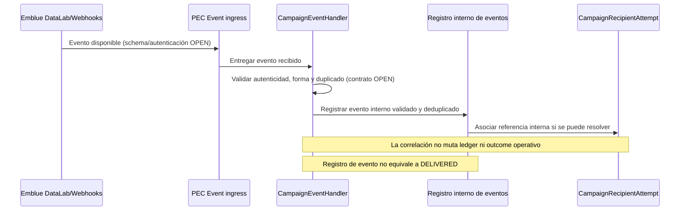
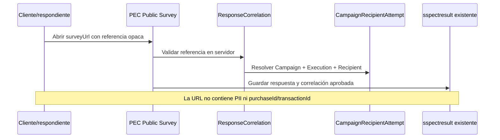

# PEC-SC-INTEG-001 — Especificación de Integraciones

## Automated Survey Campaigns

| Campo | Valor |
|---|---|
| Documento | PEC-SC-INTEG-001 |
| Título | Especificación de Integraciones - Automated Survey Campaigns |
| Estado | DRAFT |
| Versión | 0.4 |
| Fecha | 2026-10-20 |
| Idioma | Español; nombres técnicos en inglés |

> Este documento describe las fronteras funcionales de integración aprobadas para Automated Survey Campaigns. Los contratos de CF/Analytics y Emblue no han sido entregados; los detalles que dependen de ellos se identifican como **OPEN**. No define endpoints externos concretos ni sustituye ARCH-001, FOUND-001, DATA-001 o API-001.

## 1. Propósito y alcance

Documentar cómo PEC obtiene compras/clientes elegibles, solicita el envío transaccional de invitaciones por Emblue y procesa eventos de entrega disponibles. También establece responsabilidades, tratamiento de fallos, correlación, seguridad y observabilidad requeridos para concretar esos contratos.

Se describen contratos conceptuales. No se fijan rutas, esquemas JSON de proveedor, credenciales, cuotas ni tamaños de lote. Los adapters propuestos son componentes internos y no amplían el contrato Angular de API-001.

## 2. Fuentes y clasificación de información

- **Decisión aprobada:** PEC → Emblue Transactional Email API para invitaciones; Emblue → PEC por DataLab/Webhooks para eventos.
- **Decisión aprobada:** PEC conserva autoridad sobre Campaign, segmentación, post-purchase offset, Scheduler, deduplicación, ejecución y ledger de destinatarios. Emblue administra templates y entrega de email.
- **Decisión aprobada:** SurveyJS ya existe. Campaign referencia una encuesta existente; no crea encuestas.
- **Verificado en código:** el API PEC usa `HttpService` de NestJS/Axios en servicios como `ClientService`, `TcaService` y `CollaboratorService`; esos patrones usan configuración para base URL, transformación de respuestas y el helper `handleExternalHttpError` para mapear fallos HTTP.
- **Verificado en código:** hay clientes con autenticación Bearer y configuración por ambiente. No existe un único patrón uniforme para todos los proveedores.
- **Verificado en código:** `requestDiagnostics` genera `X-Request-ID` y contexto de diagnóstico; el logger incluye sanitización de valores sensibles. Las integraciones nuevas deben evitar payloads completos en logs aun con sanitización.
- **Verificado en código:** no se encontró un adaptador Emblue ni un adaptador de audiencia CF/Analytics para esta funcionalidad.
- **OPEN:** los patrones existentes no demuestran el contrato, autenticación, capacidades ni políticas de los proveedores de esta funcionalidad.

## 2.1 Catálogos Campaign: MOCK temporal

**APPROVED/MOCK:** los contratos reales CF/Analytics no están disponibles. Campaign usa una abstracción propia de proveedor, independiente de servicios generales PEC. El contrato entrega seis catálogos: Division, Department, Company, Auxiliary Classification, Format y Store; no incluye Auxiliary Subclassification en V1.

El proveedor Mock usa IDs/nombres sintéticos identificados como `[MOCK]`/`MOCK-*`. Las relaciones padre-hijo son fixtures de demostración para probar multiselección y limpieza de incompatibles; no describen jerarquías confirmadas de CF. Cada opción tiene `id`, `label`, `parentId` cuando aplique, `active` y `source`. El contrato Angular no cambia al sustituir el proveedor.

MOCK se activa explícitamente con `CAMPAIGN_CATALOG_PROVIDER=mock`, el backend lo rechaza en `NODE_ENV=production` y no cae automáticamente a MOCK ante error de Analytics. El proveedor Analytics es un seam no configurado: no se inventan endpoints, autenticación ni payloads.

Las etiquetas sintéticas MOCK que se muestran en Angular están en español y conservan el prefijo visible de demostración, por ejemplo `[MOCK] División Norte` y `[MOCK] Local Quito Centro`. Se conservan los IDs actuales y la forma de respuesta API; no se localizan ni alteran campos técnicos.

Division, Department y Company son obligatorios solo al programar; se permiten incompletos en DRAFT. Auxiliary Classification, Format y Store son opcionales. Backend valida IDs y relaciones usando el proveedor configurado. Estos catálogos no determinan audiencia, recipients ni envíos; scheduler, Audience Preview real y correos quedan **DEFERRED** mientras no existan contratos reales. Enterprise PEC y Company externa no se equiparan.

## 3. Ownership matrix

| Capacidad / dato | PEC | CF / Analytics | Emblue | SurveyJS / Surveys |
|---|---|---|---|---|
| Campaign, calendario, filtros y offset | Autoritativo: configura y valida | — | — | — |
| Catálogos externos de segmentación y compras/clientes | Consume por adapter; conserva solo lo necesario | Proporciona fuente y significado de datos, pendiente de confirmar | — | — |
| Elegibilidad, audiencia incremental y deduplicación | Calcula/coordina; clave interna `campaignId + purchaseId/transactionId` | Proporciona los datos de compra/cliente requeridos | — | — |
| Template de email | Selecciona la referencia que se acuerde y aporta variables permitidas | — | Propietario del contenido/configuración del template | — |
| Aceptación técnica de solicitud | Registra la respuesta técnica externa | — | Puede aceptar/rechazar según su contrato | — |
| Resultado operativo por recipient | Registra el resultado en `CampaignRecipientAttempt`, separado del ledger | — | Proporciona la respuesta disponible; el significado de `SENT` es OPEN | — |
| Entrega, aperturas, clics y rebotes | Ingiere y registra eventos disponibles, separados de aceptación y estado del ledger | — | Fuente de eventos disponibles; semántica por confirmar | — |
| Encuesta y respuesta | Mantiene Campaign/Execution/Recipient correlation | — | — | Survey existente; conserva respuesta y valida referencia opaca de atribución |
| Token de atribución | Emite/valida referencia opaca según diseño pendiente | — | No debe recibir PII ni token como variable de template por defecto | Lo consume de forma segura en flujo público, mecanismo OPEN |

## 4. Integración A — CF / Analytics

### 4.1 Responsabilidad

Proporcionar a PEC los datos de compras y clientes que correspondan a los filtros de una Campaign y al corte de elegibilidad configurado. La fuente podrá materializarse mediante vistas corporativas, API u otro mecanismo autorizado. No se asume cuál hasta que el propietario de datos entregue el contrato.

Filtros funcionales a evaluar:

- `Divisions` — obligatorio.
- `Departments` — obligatorio.
- `Auxiliary Classifications` — opcional.
- `Companies` — obligatorio.
- `Formats` — opcional.
- `Stores` — opcional.
- Elegibilidad post-compra derivada de `PostPurchaseOffset` y `evaluationDate`: `PurchaseDate + PostPurchaseOffset <= evaluationDate`; zona y corte exacto OPEN.

No se contemplan Auxiliary Subclassification ni rangos manuales de fechas de compra. Los filtros multiselect conservan la semántica aprobada: OR entre valores del mismo grupo y AND entre grupos distintos. PEC debe enviar/aplicar criterios equivalentes según permita el contrato real; la ubicación del filtrado (fuente, PEC o combinación) queda OPEN.

### 4.2 Contrato conceptual de consulta

El adapter interno `AudienceSourceProvider` recibirá una solicitud conceptual con:

| Dato | Propósito |
|---|---|
| `campaignId`, `executionId` | Trazabilidad interna; no se presupone que se envíen al sistema fuente. |
| `divisionIds`, `departmentIds`, `auxiliaryClassificationIds` | Criterios de segmentación multiselect. |
| `companyIds`, `formatIds`, `storeIds` | Criterios comerciales multiselect. |
| `postPurchaseOffset` | Días mínimos después de la compra. |
| `evaluationDate` / cutoff | Fecha de negocio contra la que se determina elegibilidad; zona horaria y semántica exactas del corte OPEN. |
| cursor/página conceptual | Permitir consumo incremental de resultados si el origen lo soporta; mecanismo OPEN. |

El resultado conceptual por compra incluirá los datos mínimos disponibles:

| Campo conceptual | Uso | Tratamiento |
|---|---|---|
| `customerId` | Identificación y asociación interna | Identificador externo; tipo y estabilidad OPEN. |
| `purchaseId` o `transactionId` | Deduplicación por Campaign | Uno de ellos debe ser estable y único en su ámbito; elección y semántica OPEN. |
| `email` | Destino requerido para solicitar invitación | PII; usar transitoriamente y persistir solo según política aprobada. |
| `purchaseDate` | Evaluación de offset y variable opcional | Zona horaria/calendario del origen OPEN. |
| `customerName` | Personalización opcional | PII; solo enviar si existe y es necesario. |
| `companyName`, `formatName`, `storeName` | Personalización opcional | Datos de negocio; opcionales según disponibilidad. |
| otros campos aprobados | Variables de template futuras | No aceptar campos arbitrarios; revisar propósito y sensibilidad antes de habilitarlos. |

Los nombres anteriores son **conceptuales**, no nombres de columnas garantizados. La vista previa de audiencia se calcula en backend y presenta conteos `Eligible Purchases` y `Eligible Customers`; Angular no recibe la lista completa de emails ni el payload original. La audiencia de campañas recurrentes es incremental: cada ejecución evalúa compras elegibles y excluye las ya procesadas por esa Campaign. Un fallo total de lectura no marca compras pendientes como procesadas; deben poder considerarse en ejecuciones posteriores. La recuperación tras downtime debe consolidar el trabajo pendiente, sin crear una ráfaga de ejecuciones atrasadas. No se impone watermark ni lookback; los mecanismos concretos de paginación, recuperación y reconciliación con la fuente permanecen OPEN. Los resultados y snapshots de ejecuciones terminales permanecen inmutables.

### 4.3 OPEN de CF / Analytics

- **OPEN-CF-01:** nombres reales de vistas, endpoints o recurso autorizado.
- **OPEN-CF-02:** conexión, protocolo, ambiente, autenticación, credenciales y propietario operativo.
- **OPEN-CF-03:** columnas reales, tipos, nulabilidad, códigos, jerarquías y semántica de filtros.
- **OPEN-CF-04:** identificador único definitivo de compra (`purchaseId`/`transactionId`) y su ámbito de unicidad/retención.
- **OPEN-CF-05:** relación autoritativa entre compra, cliente, email, Company, Division, Department, Auxiliary Classification, Format y Store.
- **OPEN-CF-06:** estrategia de paginación/lotes, orden estable, límite de consulta y comportamiento ante cambios durante lectura.
- **OPEN-CF-07:** volumen esperado/máximo, concurrencia, SLAs, disponibilidad, latencia y actualización de datos.
- **OPEN-CF-08:** fecha de compra tardía/corregida, zona horaria y corte preciso para `PurchaseDate + PostPurchaseOffset <= evaluationDate`.
- **OPEN-CF-09:** reglas de calidad de email, duplicados, clientes sin correo, bajas/supresión y datos personales autorizados.
- **OPEN-CF-10:** comportamiento acordado ante resultado parcial, respuesta truncada o fallo entre páginas.

## 5. Integración B — Emblue

### 5.1 Responsabilidad y límites

PEC → Emblue Transactional Email API solicita el envío de invitaciones con el template previamente administrado en Emblue. PEC no administra ni replica el contenido del template. Emblue gestiona la aceptación y entrega de email, así como las métricas/eventos que efectivamente exponga.

Emblue → PEC por DataLab/Webhooks transporta eventos disponibles. Estos eventos complementan el registro transaccional de PEC: no reemplazan el ledger de recipients ni la atribución de respuestas de Survey.

### 5.2 Abstracción `EmblueProvider`

Se propone un adapter interno `EmblueProvider` que aísle el dominio de Campaign del protocolo externo. Como mínimo debe cubrir conceptualmente:

1. Resolver la configuración/credencial del ambiente sin exponerla en código, DTOs o logs.
2. Recibir solicitudes de envío transaccional construidas por PEC.
3. Traducir estados/respuestas externas a resultados internos por recipient, conservando referencias externas cuando existan.
4. Clasificar fallos transitorios, permanentes y ambiguos cuando el contrato lo permita.
5. Exponer capacidades confirmadas del proveedor, sin asumir tamaños, límites o estados no documentados.

Este nombre es una propuesta de separación interna; no es una clase existente verificada ni obliga a una tecnología concreta.

### 5.3 Contrato conceptual de envío

PEC prepara un mensaje por compra elegible; puede agruparlos en llamadas por lotes si el contrato real lo permite. La solicitud conceptual contiene:

| Dato conceptual | Requerimiento |
|---|---|
| Referencia/template de Emblue | Identificador externo y selección del template quedan OPEN; el contenido se mantiene bajo ownership de Emblue. |
| `email` | Destinatario requerido por el envío; PII, limitado al propósito y no registrado en logs. |
| `surveyUrl` | Variable requerida. Debe dirigir a la encuesta publicada y portar solo la referencia segura de atribución aprobada. |
| `customerName` | Variable opcional. |
| `companyName` | Variable opcional. |
| `formatName` | Variable opcional. |
| `storeName` | Variable opcional. |
| `expirationDate` | Variable opcional; significado y cálculo sujetos a regla funcional aprobada. |
| `surveyName` | Variable opcional. |
| `purchaseDate` | Variable opcional. |
| `purchaseId` / `transactionId` | Identificador interno de PEC; no visible por defecto en el template ni enviado como variable de personalización. |
| referencias internas de correlación | PEC conserva `campaignId`, `executionId`, `recipientId` y la relación con la compra. Solo se envían campos de correlación técnica si el contrato de Emblue los admite y se aprueba su uso. |

Respuesta conceptual: Emblue puede confirmar técnicamente la aceptación/rechazo de una solicitud o elemento y podría entregar una referencia externa; campos, cardinalidad y semántica **no están definidos**. Esa aceptación técnica es distinta del resultado operativo por recipient que PEC registra en `CampaignRecipientAttempt`, y ambos son distintos de eventos posteriores de entrega recibidos por DataLab/Webhooks. `SENT` no equivale a `DELIVERED`; el significado definitivo de `SENT` permanece OPEN hasta validar el contrato real. El ledger `CampaignRecipient` conserva la identidad única por Campaign + Purchase y no se sustituye por la respuesta externa ni por eventos.

### 5.4 Lotes, timeout, retry e idempotencia

- **Batches:** el adapter debe poder operar dentro de los límites confirmados por Emblue. El tamaño y concurrencia no se fijan aquí. Si el proveedor no permite lotes, el adapter deberá ajustarse a su operación documentada.
- **Timeout:** definir límites de conexión/respuesta por ambiente al conocer latencias y contrato. Un timeout después de transmitir puede dejar resultado ambiguo; PEC no debe asumir que no hubo envío.
- **Retry:** la política debe distinguir rechazo permanente, fallo transitorio y resultado ambiguo. Un reintento automático requiere evidencia de que no duplica el envío o soporte de idempotencia/reconciliación del proveedor. Máximo de intentos, backoff, jitter y ventana quedan OPEN.
- **Idempotencia:** PEC aplica deduplicación interna por `campaignId + purchaseId/transactionId`. Si Emblue soporta idempotency key, el adapter podrá complementarla con una clave estable y segura; formato, alcance y retención quedan OPEN. La idempotencia interna no prueba que el proveedor la soporte.
- **Circuit breaker:** se propone evaluar un circuit breaker para aislar indisponibilidad sostenida, con estados/umbrales configurables y operación observable. Umbrales, ventanas, timeout de recuperación y si se incorpora al primer release quedan OPEN; no es comportamiento existente verificado.
- **Recovery:** los reintentos/reprocesos no deben alterar snapshots ni estados terminales históricos de `CampaignExecution`; cada intento/outcome conserva trazabilidad en `CampaignRecipientAttempt` según DATA-001. El momento de marcar un recipient `SENT`/final y la reconciliación quedan sujetos al contrato de respuesta/eventos.

La reserva temporal de un Recipient es distinta del procesamiento efectivo y del resultado del intento. DATA-001 propone `reservedAt`, `reservationOwner` y `reservationExpiresAt` para identificar y recuperar una reserva; `firstProcessedAt` solo corresponde al primer resultado que la política acordada considere procesado, no al instante de reserva. Una reserva no significa envío exitoso ni compra definitivamente procesada. Una reserva abandonada/expirada debe poder recuperarse sin causar un envío duplicado; se conserva el ledger único Campaign + Purchase y el historial de `CampaignRecipientAttempt`. No se vuelve a solicitar un envío ya confirmado. Si el resultado externo es ambiguo, no se reintenta a ciegas: la vía concreta de idempotencia/reconciliación depende del contrato real de Emblue y permanece OPEN. La política de retries no queda decidida aquí.

### 5.5 DataLab / Webhook ingestion

Se propone un `CampaignEventHandler` para recibir datos de DataLab/Webhooks, validar autenticidad e integridad según mecanismo entregado, mapear eventos confirmados y asociarlos a referencias de mensaje/recipient cuando el proveedor las ofrezca.

El procesamiento debe:

- validar origen/autenticidad antes de aceptar el evento; método de firma/autenticación OPEN;
- evitar aplicar dos veces un mismo evento, usando identificador estable del proveedor si existe; clave y retención OPEN;
- tolerar reintentos y llegada fuera de orden; precedencia/transiciones de estado OPEN;
- guardar únicamente lo requerido para trazabilidad/operación, sanitizado y con retención aprobada;
- separar la aceptación técnica de la solicitud, el resultado operativo almacenado en `CampaignRecipientAttempt`, el estado del ledger `CampaignRecipient` y los eventos de entrega/deliverability;
- no equiparar `SENT` con `DELIVERED`; el significado interno de `SENT` y cualquier reconciliación con eventos quedan OPEN hasta validar el contrato;
- no actualizar el estado Campaign/Execution de forma que contradiga resultados ya registrados sin una regla de reconciliación aprobada.

Eventos solicitados para análisis: opens, clicks y bounces. Su disponibilidad, granularidad, semántica, campos, restricciones de privacidad y forma de acceso por DataLab/Webhooks son OPEN. No se prometen indicadores en el Dashboard hasta confirmar y validar esos eventos.

### 5.6 Correlación de respuesta

El enlace `surveyUrl` es obligatorio. Debe contener una referencia opaca, no predecible y sin datos personales. No debe incluir email, `customerId`, `purchaseId`, `transactionId`, credenciales ni token de Emblue. PEC necesita poder relacionar una respuesta existente con Campaign, Execution y Recipient mediante validación server-side de esa referencia. El mecanismo, vencimiento, almacenamiento, usos permitidos, revocación y cambios al flujo público existente de Survey son **OPEN**.

El token de atribución no se expone como variable de template independiente por defecto; se incorpora únicamente a la URL segura generada por PEC. No se presupone que Emblue persista o devuelva esa URL completa en sus eventos.

## 6. Diagramas de secuencia conceptuales

### 6.1 Resolución de audiencia, reserva y envío

```mermaid
sequenceDiagram
    participant Scheduler as PEC Scheduler
    participant Exec as Campaign Execution
    participant Resolver as AudienceResolver
    participant Source as CF/Analytics Source
    participant Ledger as CampaignRecipient ledger
    participant Attempts as CampaignRecipientAttempt
    participant Provider as EmblueProvider
    participant Emblue as Emblue Transactional Email API

    Scheduler->>Exec: Reclamar ejecución vencida
    Exec->>Resolver: Resolver filtros + offset + cutoff
    Resolver->>Source: Consultar compras/clientes elegibles (contrato OPEN)
    Source-->>Resolver: Páginas/registros conceptuales (formato OPEN)
    Resolver->>Ledger: Excluir campaignId + purchaseId/transactionId ya procesados
    Resolver->>Ledger: Crear/obtener ledger único y reservar temporalmente
    Note over Ledger: reservedAt, reservationOwner, reservationExpiresAt
    Resolver->>Attempts: Crear registro PENDING por Execution + Recipient
    Note over Ledger,Attempts: reservedAt/owner/expiry son reserva; no equivalen a envío ni a firstProcessedAt
    Resolver->>Ledger: Continuar procesamiento con reserva vigente
    Resolver->>Provider: Enviar template + email + variables permitidas + surveyUrl
    Provider->>Emblue: Solicitud transaccional (endpoint/auth OPEN)
    Emblue-->>Provider: Aceptación técnica/rechazo/referencias (semántica OPEN)
    Provider-->>Attempts: Registrar resultado operativo por recipient
    Note over Attempts: SENT no implica DELIVERED; significado de SENT OPEN
    Attempts-->>Ledger: Actualizar proyección solo según outcome operativo persistido
    Note over Ledger,Attempts: firstProcessedAt solo según regla confirmada; no al reservar
    Ledger-->>Exec: Conteos y trazabilidad sin PII
    Exec-->>Scheduler: Estado de ejecución y próxima fecha según reglas PEC
```

Si la lectura de fuente falla totalmente, no se confirma como procesada la audiencia pendiente. Las compras siguen disponibles para consideración posterior; la recuperación puede agrupar el pendiente en una ejecución consolidada y no debe materializar una ejecución por cada frecuencia omitida. La ejecución fallida y su snapshot terminal no se reabren ni mutan; la relación y mecanismo de recuperación quedan OPEN. El vencimiento de una reserva permite recuperarla, mientras la clave única Campaign + Purchase y el historial de Attempts evitan duplicar envíos confirmados. No se establece aquí watermark ni lookback obligatorio.

### 6.2 Ingesta de eventos Emblue



### 6.3 Acceso a la encuesta y atribución de respuesta



Los diagramas son flujo objetivo. Los nombres de adapter y participantes representan responsabilidades conceptuales, no módulos implementados.

## 7. Escenarios de fallo

| Escenario | Comportamiento funcional esperado | Decisión OPEN |
|---|---|---|
| Fallo total de lectura de fuente CF o timeout | Registrar fallo sanitizado; no declarar audiencia vacía ni marcar compras pendientes como procesadas. Las compras no procesadas pueden recuperarse en ejecuciones posteriores mediante recuperación consolidada, sin ráfaga por cada frecuencia omitida. El estado terminal y snapshot de la Execution fallida permanecen inmutables. | Paginación, recuperación, reconciliación con fuente y enlace de ejecuciones. No se impone watermark ni lookback. |
| Fuente devuelve página incompleta, esquema inesperado o datos inválidos | No asumir que el conjunto está completo. Registrar fallo parcial, conservar trazabilidad y evitar envío parcial salvo que negocio apruebe esa semántica. | Atomicidad por lote, tolerancia a registros defectuosos y cómo reanudar cursor. |
| Compra repetida en fuente | Usar el ledger único Campaign + ID estable de compra; una reserva activa/expirada no se confunde con resultado de envío. Si se detecta duplicado, registrar el outcome pertinente en `CampaignRecipientAttempt` sin crear otro Recipient ni solicitar otro envío por esa detección. | Identificador definitivo, coordinación de reservas y resolución de IDs conflictivos. |
| Registro elegible sin email utilizable | No solicitar envío para ese registro; contabilizarlo de forma agregada y sanitizada. | Validación de email, categoría de exclusión y regla de supresión/consentimiento. |
| Emblue rechaza template, credencial o destinatario | Registrar fallo por recipient cuando el contrato permita identificarlo; no reintentar errores permanentes automáticamente. | Códigos, estados y política de credenciales/template. |
| Emblue limita o rechaza por volumen | Respetar límites confirmados, pausar/regular lotes y no descartar pendientes. | HTTP/código real, ventanas de cuota, `Retry-After` y concurrencia. |
| Timeout después de enviar la solicitud | Tratar como ambiguo; reconciliar por referencia/consulta o usar idempotencia confirmada antes de repetir. | Mecanismo de consulta y clave soportada por Emblue. |
| Webhook sin autenticidad válida | Rechazar sin cambiar estado de Campaign/Recipient; emitir señal operativa sin registrar secretos ni payload completo. | Respuesta HTTP esperada por Emblue, firma y umbrales de alerta. |
| Evento repetido o fuera de orden | Deduplicar y aplicar solo transiciones permitidas; preservar historial de recepción. | ID de evento, retención de deduplicación y orden de estados. |
| No se puede correlacionar un evento o una respuesta | Conservar el evento/respuesta según la política acordada como no correlacionado, sin asociarlo heurísticamente a una persona. | Retención, cola de revisión y mecanismo de reconciliación. |

## 8. Seguridad, privacidad y PII

- El acceso a CF/Analytics y Emblue se realiza únicamente desde servicios backend autorizados; Angular no recibe secretos ni consulta directamente esas fuentes.
- Las credenciales se configuran fuera del código y se separan por ambiente. Formato, rotación, vault y mecanismo de entrega dependen de la política PEC y del contrato externo (**OPEN**).
- `email` y `customerName` son datos personales. Se usan para resolver/solicitar el envío y se minimizan en persistencia y retención conforme DATA-001 y política pendiente.
- No escribir emails completos, nombres, payloads completos, secretos, tokens de proveedor o URL de atribución completa en logs. Registrar `campaignId`, `executionId`, referencia técnica no sensible, fase, duración, conteos agregados y códigos sanitizados.
- No incluir PII, `purchaseId` ni `transactionId` en URL. La URL porta solo la referencia opaca de correlación aprobada.
- No devolver destinatarios completos, identificadores de compra ni tokens en API administrativa salvo permiso y decisión específica; los contratos API existentes ya los excluyen por defecto.
- Los eventos de opens/clicks pueden ser datos personales o identificadores de tracking; limitar acceso y retención y no exponer métricas sin aprobación de privacidad.
- El ingreso de webhooks debe prevenir suplantación y replay. Requisitos concretos de firma, timestamp, nonce/IP allowlist y ventana anti-replay quedan OPEN hasta conocer capacidades del proveedor y revisar seguridad.
- La política de consentimiento, bajas/supresión y exclusiones de comunicación debe ser definida por negocio/privacidad antes de producción; no se infiere del mecanismo de deduplicación.

## 9. Timeout, resiliencia y observabilidad

### 9.1 Comportamiento propuesto

- Configurar timeout de conexión y respuesta por integración y operación, con límites consistentes con el SLA confirmado.
- Diferenciar fallo de conexión, timeout, rechazo externo, límite de cuota y respuesta inválida. Evitar convertir fallo de origen en audiencia vacía.
- Aplicar reintentos acotados solo ante fallos transitorios y con estrategia de idempotencia/reconciliación; resultados ambiguos no se reenvían a ciegas.
- Evaluar circuit breaker para indisponibilidad sostenida. Umbrales y estados operativos deberán ser configurables y observables si se adopta.
- No mantener transacciones/locks de base de datos abiertos durante llamadas a los proveedores; el claim compartido de Scheduler y los intentos persistidos se resuelven en PEC según ARCH/DATA.

Los valores de timeout, retries, backoff, jitter, circuit breaker, expiración de lease y ventana de recuperación permanecen OPEN. Nest/Axios y patrones de error existentes son referencias del código, no valores de configuración aprobados para estas integraciones.

### 9.2 Señales de observabilidad

Registrar de forma estructurada y sanitizada:

- IDs internos `campaignId` y `executionId`, `X-Request-ID` para solicitudes administrativas y un identificador de operación/lote no sensible;
- sistema destino/origen, etapa, duración, resultado, código de error normalizado y número de intento;
- conteos de compras consultadas, elegibles, deduplicadas, sin destino, aceptadas/rechazadas cuando sean comprobables;
- referencias externas de Emblue solo si son opacas, necesarias y aprobadas;
- salud y antigüedad de ejecuciones/eventos pendientes, fallas repetidas y resultados ambiguos.

No crear métricas de aperturas, clics, rebotes ni entrega hasta confirmar que los eventos son proporcionados, interpretables y reconciliables. Stack de métricas/alertas, retención, dashboards y umbrales del entorno PEC: **OPEN**.

## 10. Contratos conceptuales resumidos

### `AudienceSourceProvider`

- **Entrada:** filtros multiselect, `postPurchaseOffset`, cutoff/fecha de evaluación y cursor conceptual.
- **Salida:** registros conceptuales de compra/cliente con customer/purchase ID, email y fecha de compra; datos de personalización opcionales.
- **Garantía que necesita PEC:** identidad de compra suficientemente estable, semántica conocida de filtros y capacidad para saber si se completó la lectura.
- **Contrato externo:** OPEN; los campos no son nombres de columnas acordados.

### `EmblueProvider`

- **Entrada:** referencia de template confirmada, destinatario, `surveyUrl` obligatoria y variables opcionales aprobadas.
- **Salida:** resultado conceptual por destinatario y referencias externas disponibles.
- **Garantía que necesita PEC:** poder distinguir aceptación, rechazo y resultado ambiguo en la medida que lo permita Emblue.
- **Contrato externo:** OPEN; no hay rutas, campos de request/response ni autenticación definidos.

### `CampaignEventHandler`

- **Entrada:** evento externo recibido por DataLab/Webhooks.
- **Salida:** evento autenticado, deduplicado, correlacionado y registrado internamente cuando sea posible. No actualiza por sí mismo el ledger ni el resultado operativo; cualquier transición requiere regla aprobada.
- **Contrato externo:** OPEN; no se presuponen schema, firma, event ID, entrega, replay ni semántica.

## 11. OPENs y responsables sugeridos

| ID | Pendiente | Responsable sugerido |
|---|---|---|
| OPEN-INTEG-01 | Contrato CF/Analytics: vistas/endpoints y owner | Equipo de datos/Analytics |
| OPEN-INTEG-02 | Conexión, autenticación, permisos, ambientes y credenciales de CF | Equipo de datos/infraestructura |
| OPEN-INTEG-03 | Columnas, jerarquías y filtros de CF; identificador único de compra | Equipo de datos/negocio |
| OPEN-INTEG-04 | Paginación/lotes, orden, volúmenes, límites, frescura y SLAs de CF | Equipo de datos/operación |
| OPEN-INTEG-05 | Cutoff, zona horaria, fecha tardía y regla temporal exacta de elegibilidad | Negocio/datos |
| OPEN-INTEG-06 | Documentación Emblue Transactional Email API, endpoint, versión y autenticación | Equipo PEC/Emblue |
| OPEN-INTEG-07 | Template ownership/configuración, referencia externa y ambiente de pruebas | Equipo PEC/Emblue |
| OPEN-INTEG-08 | Variables, formato y escape/render de template; respuesta por mensaje y referencias externas | Equipo PEC/Emblue |
| OPEN-INTEG-09 | Tamaño de lote, límites, cuotas, timeout recomendado y estados/códigos de rechazo | Equipo PEC/Emblue |
| OPEN-INTEG-10 | Soporte, alcance y retención de idempotency key; consulta/reconciliación de envíos ambiguos | Equipo PEC/Emblue |
| OPEN-INTEG-11 | Política de retry, backoff, jitter, circuit breaker y recovery | PEC/operación/Emblue |
| OPEN-INTEG-12 | DataLab/Webhooks: eventos disponibles, schema, autenticación/firma, replay, reintentos y orden | Equipo PEC/Emblue |
| OPEN-INTEG-13 | Garantías de opens/clicks/bounces, semántica y restricciones de privacidad | Equipo PEC/Emblue/privacidad |
| OPEN-INTEG-14 | Correlación de respuesta: token opaco, expiración, almacenamiento y cambios en Survey público | Equipo Surveys/seguridad |
| OPEN-INTEG-15 | Retención y tratamiento de emails, compras, logs y eventos; consentimiento y supresión | Negocio/privacidad/seguridad |
| OPEN-INTEG-16 | Stack de observabilidad, métricas, alertas y umbrales operativos | Operación PEC |

## 12. Criterio de cierre de la especificación de integración

Antes de habilitar envíos productivos deben estar documentados y revisados los contratos reales de CF/Analytics y Emblue, la autenticación por ambiente, esquema y semántica de datos, límites de lectura/envío, manejo de respuestas ambiguas, idempotencia/reintentos, autenticidad de eventos, correlación de respuestas y controles de privacidad/retención. La aprobación de esta lista no presupone que esos contratos ya existan ni modifica las decisiones funcionales aprobadas.

## 13. Historial de cambios

| Versión | Fecha | Cambios |
|---|---|---|
| 0.2 | 2026-10-18 | Se explicita la recuperación de compras pendientes tras fallos de lectura sin watermark/lookback ni ráfagas; se distinguen reserva, procesamiento y outcomes; se separan aceptación técnica, resultado operativo y eventos de entrega; se dividen los flujos de webhook y atribución de Survey. |
| 0.3 | 2026-10-20 | Se añade proveedor MOCK exclusivo de Campaign, contrato estable reemplazable, datos sintéticos y reglas de seguridad; se separan sus catálogos de la audiencia real CF/Analytics y se difieren scheduler/envíos con MOCK. El documento permanece DRAFT. |
| 0.4 | 2026-10-20 | Se requiere presentar etiquetas de catálogos MOCK en español, conservando IDs, source y contrato API. Estado DRAFT conservado. |
